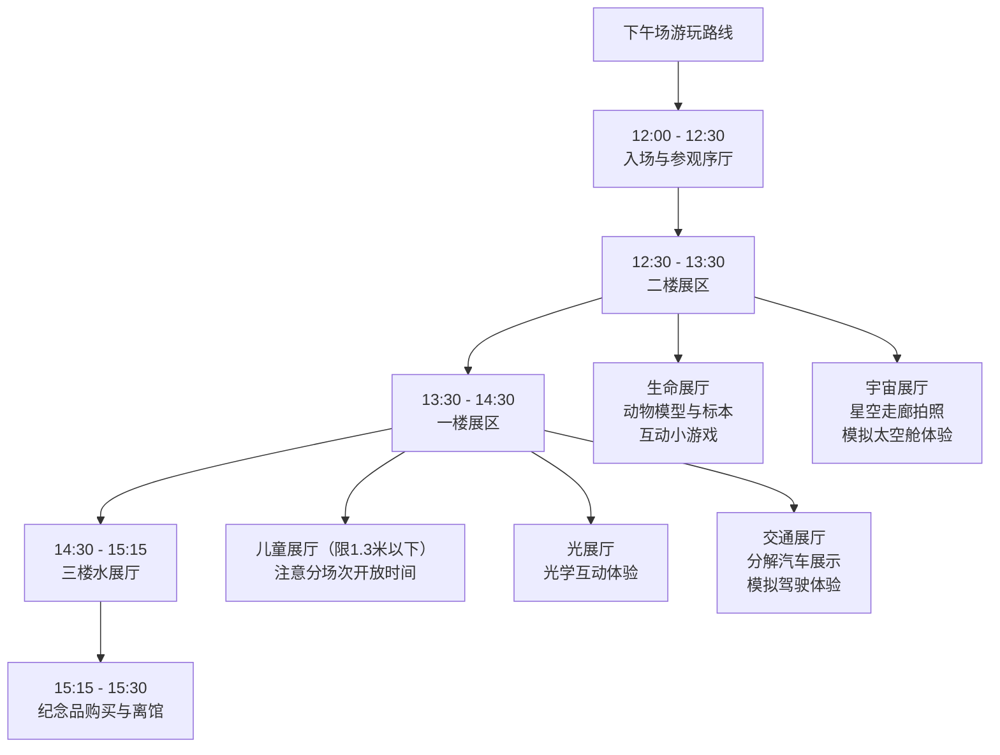

# 🏛️ 武汉科技馆下午场亲子游玩攻略

## ✨ 基本信息

-   **开放时间**：下午场 **12:00-15:30**（15:30停止入馆），**周三至周日**开放（周一、周二闭馆）。
-   **预约方式**：通过“武汉科学技术馆”官方微信公众号进行免费预约。**注意**：去几个人就要预约几张票，小朋友也需要预约。
-   **地址**：武汉市江岸区沿江大道91号（原武汉客运港大楼）。
-   **联系电话**：027-50755500, 027-50750732。

## 🗺️ 下午场游玩路线建议

鉴于下午场时间有限（仅3.5小时），建议您有所侧重地游览。对于带孩子的家庭，可以参考以下路线规划：

## 🎯 各楼层重点推荐

### 1. 二楼展区（入口层）
-   **生命展厅**：这里有各种动物模型和从比利时进口的逼真动物标本（狮子、棕熊、灰狼等）。不要错过“**与恐龙赛跑**”的互动游戏，孩子通过原地跑步与屏幕上的恐龙竞赛，既有趣又能消耗体力。
-   **宇宙展厅**：这是科技馆中最受欢迎的展厅之一。**星空走廊**非常适合拍照；还可以观看**天文爱好者拍摄的160多幅天文美图**；按0.7比例模拟建造的“**天宫一号**宇宙空间站”和**模拟太空舱**也很受孩子欢迎。

### 2. 一楼展区
-   **儿童展厅**（**仅限1.3米以下儿童**，每位儿童可携带1-2名大人）：这是孩子们的乐园，面积达2300㎡。特色包括**滑梯连接二、三楼**、**挖掘机**（通常需排队）、**戏水乐园**、**攀岩墙**、**虚拟足球赛**等。**请注意**：儿童展厅下午场次通常**分时段开放**（例如可能分13:00-15:00的场次），建议入场后先确认具体开放时间。
-   **光展厅**：互动性很强，孩子可以体验**没有琴弦的吉他和古琴**、**没有鼓面的架子鼓**，还有“下半身消失”等有趣的光学现象。
-   **交通展厅**：这里有一台**被分解的雪铁龙汽车**，拍照很有科幻感；还可以体验**模拟驾驶高铁、轮船或卡车**。

### 3. 三楼展区
-   **水展厅**：展示了近40种与水有关的科学现象，小朋友可以通过动手实验来学习水科学。这里还设有**专门的儿童望远镜**，可以观看江面和江对岸的景色。

## 💡 实用贴士

-   **时间管理**：下午场12:00开始，但**15:30就停止入馆**了，时间其实挺紧张。建议早点到，预留出签到、存包的时间。
-   **互动项目时机**：馆内有些体验互动项目是**限时开放**的，大多在**14:00-15:00**时段。建议提前在公众号或馆内导览图上了解当天的时间安排，合理规划。
-   **带孩子必备物品**：
    -   推车（馆内面积大，孩子容易累）
    -   隔汗巾、备用衣物（尤其是裤子，玩水可能打湿）
    -   水壶（馆内有直饮水机可补充）
    -   少量健康零食（馆内有贩卖机，但自带更经济）
-   **场馆服务**：馆内提供**免费存包柜**、**直饮水机**、**自动贩卖机**（出售饮料和零食）和**母婴室**。
-   **温度提示**：馆内每层楼可能有些许温差，建议为孩子准备一件**薄长袖**以备不时之需。
-   **避开人流**：下午场刚开始时（12点左右）人相对较少，可以先逛热门展厅。儿童展厅通常人气很高，注意其分场次开放时间并合理安排。

## 🚗 交通信息

-   **地铁**：乘坐地铁2号线或6号线至【**江汉路站**】，从C出口出站后步行约15-20分钟可达。
-   **轮渡**：乘坐轮渡至【**武汉关码头**】，然后步行前往。
-   **自驾**：科技馆旁有停车场，**收费为6元/小时**，白天40元封顶。但节假日车位可能紧张，建议早点到或选择公共交通。

## 🤔 如何让参观更有收获

-   鼓励孩子多动手尝试互动展品，边玩边学。
-   利用馆内的“**天问之树**”APP（如果有的话）进行互动答题，增加趣味性。
-   对于大一点的孩子，可以结合展品内容，聊聊相关的科学原理或生活中的应用。
-   尊重孩子的兴趣，如果他们某个展品特别感兴趣，不妨多花点时间，不必强求看完所有内容。
